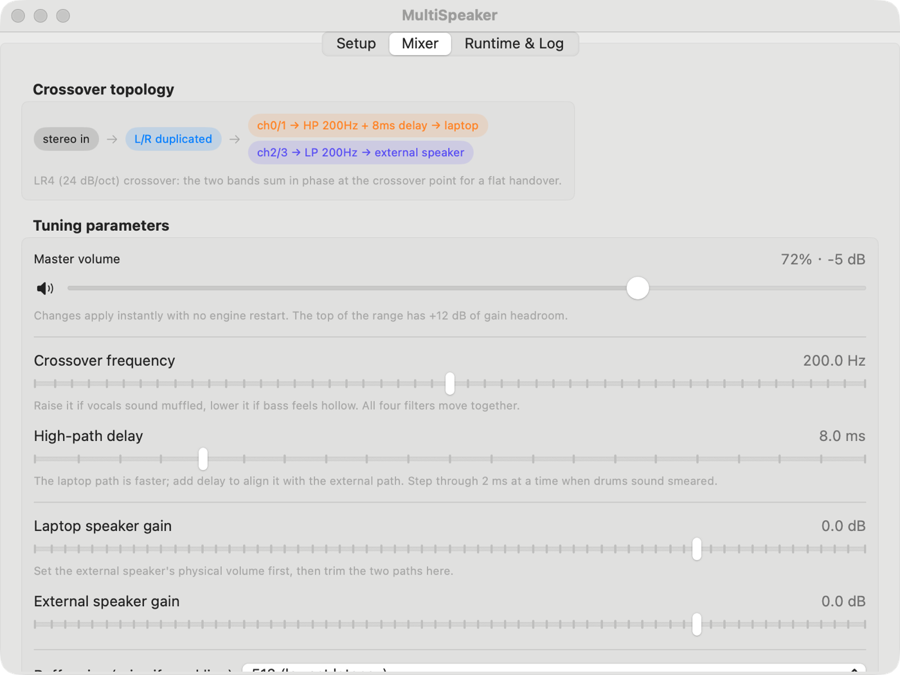
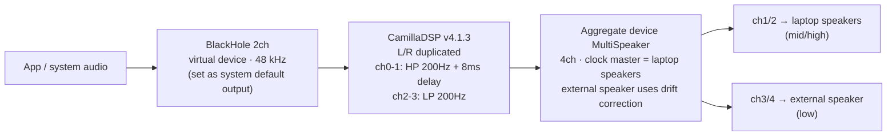

# MultiSpeaker


[中文](README.md) · **English**

Use your Mac's **built-in speakers** and an **external speaker** as one acoustic system. Instead of pushing the same full-range signal to both devices, MultiSpeaker splits the signal first — the laptop speakers handle the mid/high band, the external speaker handles the low band — then aligns the two paths with a delay trim.

macOS 14+ · Swift 6 · SwiftUI · no third-party dependencies · MIT

> Download and run. But read "First run" first — there is one microphone permission you must grant, otherwise you will get "music is playing but there is no sound".



---

## Why crossover instead of macOS's own "Multi-Output Device"

macOS's built-in Multi-Output Device copies the same full-range stereo to every device. That has three hard limits:

| Problem | Cause |
|---|---|
| Muffled, distorted bass | A 3-inch laptop driver cannot produce below ~100 Hz; feeding it full range only creates distortion |
| Phase smearing, blurry image | Two speakers at different distances sum the same bass with different delays → comb filtering |
| Level mismatch | Small drivers and external speakers differ by 10 dB+ in sensitivity, so one masks the other |

MultiSpeaker uses a real crossover: **LR4 (24 dB/oct)**, which sums in phase and flat at the crossover point, plus a 0–40 ms delay on the high path to compensate for the laptop speakers arriving first.

---

## Signal path



---

## Features

- **One-click setup**: detect/install BlackHole, create the aggregate device, switch the system default output, start the engine
- **Live volume**: applied over CamillaDSP's websocket — instant, no audio dropout; perceptual taper (halfway ≈ −12 dB) with +12 dB of headroom
- **Live tuning**: crossover 80–320 Hz, delay 0–40 ms, per-path gain, buffer size; changes hot-restart the engine 0.6 s later
- **Process supervision**: 2 s polling, automatic restart if CamillaDSP dies (gives up after 3 consecutive failures); child process is killed on quit so it never orphans and holds the devices
- **Menu bar**: closing the window keeps the app alive; filled icon = playing, outline = stopped; the panel gives you volume, start/stop and the main window
- **Bilingual UI**: follows the system language, or force Chinese/English under Runtime & Log → Language (applies instantly)
- **Launch at login** (LaunchAgent) and auto-start playback
- **Bundled engine**: CamillaDSP v4.1.3 ships inside the app
- **Log panel**: raw CamillaDSP output, no terminal needed

---

## Requirements

| Item | Requirement |
|---|---|
| OS | macOS 14 Sonoma or newer |
| Chip | Apple Silicon (release build is arm64; build from source for Intel) |
| Permission | Microphone (required — see below) |
| Disk | ~20 MB including CamillaDSP |

---

## Install

### From the release (recommended)

1. Download [`dist/MultiSpeaker.zip`](dist/MultiSpeaker.zip) (or grab it from [Releases](../../releases))
2. Unzip and drag `MultiSpeaker.app` into `/Applications`
3. **First launch**: right-click → Open in Finder (the app is ad-hoc signed, not notarised)

If macOS still says the app "is damaged", run once:

```bash
xattr -dr com.apple.quarantine /Applications/MultiSpeaker.app
```

### Build from source

```bash
git clone https://github.com/peterxulove/multispeaker-macos.git
cd multispeaker-macos
./build-app.sh          # produces MultiSpeaker.app and dist/MultiSpeaker.zip
```

Requires Xcode 16+ (Swift 6 toolchain). `Resources/camilladsp` (v4.1.3) is already in the repo.

---

## First run (5 steps)

### 1. Install BlackHole 2ch

Step 1 on the Setup page detects it. If missing, hit **Install (Homebrew)** or **Download installer**. If the device does not show up afterwards:

```bash
sudo launchctl kickstart -k system/com.apple.audio.coreaudiod
```

> BlackHole is a system audio driver, not a regular app — it needs an admin password, and some macOS versions require a reboot.

### 2. Grant microphone permission (the step that trips everyone up)

The first time you hit the one-click setup, macOS asks for microphone access. **You must allow it.**

It sounds backwards — we are playing audio, why a microphone? Because BlackHole is also an *input* device in the audio stack, and CamillaDSP has to capture from its input ports. Without the grant, the HAL does not error out; it silently returns zeros. The result is exactly "music is playing but there is no sound".

If you dismissed the prompt: System Settings → Privacy & Security → Microphone, enable MultiSpeaker, then restart the app.

### 3. Pick the two speakers

- **High band**: `MacBook Pro Speakers`
- **Low band**: your external speaker / display / audio interface

Then hit **Create / rebuild aggregate**. This creates a 4-channel aggregate device named `MultiSpeaker`: ch1/2 → high device, ch3/4 → low device.

### 4. Hit "One-click setup and start playing"

It creates the aggregate, sets BlackHole as the default output, starts CamillaDSP and begins playback. A green light means the chain is live.

### 5. Tune (optional but recommended)

On the Mixer page:

1. **Level match** — set the external speaker's physical volume first, then trim the two path gains until both speakers sound equally loud
2. **Crossover** — raise it (250–300 Hz) if vocals sound muffled, lower it (120–150 Hz) if bass feels hollow
3. **Delay** — play something with crisp drums and step 2 ms at a time; smeared or dragging kick = not aligned yet
4. **Master volume** — the keyboard volume keys do nothing through BlackHole; use the slider or the menu bar panel

---

## Menu bar

Clicking the red close button does not quit: the Dock icon disappears, the window hides, and a speaker icon stays in the menu bar.

| Icon | Meaning |
|---|---|
| 🔊 filled | CamillaDSP is playing |
| 🔈 outline | Stopped |

The popover gives you status, the two-device summary, a volume slider with mute, start/stop, "open window" and quit.

Don't want this behaviour? Turn off "Close button hides to the menu bar" under Runtime & Log.

---

## Parameters

| Parameter | Range | Default | Notes |
|---|---|---|---|
| Master volume | slider 0–100% (maps to −60 ~ +12 dB) | −5 dB | Instant, no engine restart; the keyboard volume keys don't work through BlackHole |
| Mute | toggle | off | Over websocket, no audio gap |
| Crossover | 80–320 Hz (5 Hz steps) | 200 Hz | All four filters move together, LR4 24 dB/oct |
| High-path delay | 0–40 ms (2 ms steps) | 8 ms | Added to the laptop path to align with the external one |
| Laptop speaker gain | −24 ~ +6 dB (0.5 dB steps) | 0 dB | Level matching |
| External speaker gain | −24 ~ +6 dB (0.5 dB steps) | 0 dB | Level matching |
| Buffer (chunksize) | 512 / 1024 / 2048 | 1024 | Raise it if you hear crackling; costs latency |

### The volume curve

Slider position is mapped through a **perceptual curve**, not linearly to dB. With a linear map, halfway is already −30 dB — effectively silent, which is why "turning it down a bit" used to kill the sound. Now:

| Slider | 25% | 50% | 72% | 85% | 100% |
|---|---|---|---|---|---|
| Gain | −26.5 dB | −12 dB | −5 dB | −0.1 dB | +12 dB |

- The low end is finer, so late-night listening works
- Above 85% you enter the >0 dB region, meant to squeeze the last bit out of the hardware; past +3 dB the readout turns orange as a clipping warning
- Volume and mute go through CamillaDSP's websocket (`SetVolume` / `SetMute`) — **the engine is never restarted**, so dragging is smooth

> +12 dB is digital gain, not free power. Measured on this machine, going from 0 dB to +12 dB only bought about 8 dB of acoustic level before the laptop speakers hit their limit; beyond that it just clips. If you need more, check that both speakers' own system volumes are at 100% first.

---

## Troubleshooting

**Music plays but there is no sound — check in this order**

1. Runtime & Log: is CamillaDSP `Running` (not Paused) with no red errors?
2. System Settings → Sound → Output: is it `BlackHole 2ch`? (another app can steal it)
3. System Settings → Privacy & Security → Microphone: is MultiSpeaker enabled?
4. Is the master volume near zero, or muted?
5. Setup page: is the aggregate still online? Rebuild it if something mangled it

**Crackling / dropouts** → raise the buffer to 2048. Two devices in one aggregate never share a perfectly identical clock; a small buffer compensates too often.

**Only one speaker plays** → the subdevice order got changed. Hit "Create / rebuild aggregate" (the high device must come first — it is also the clock master).

**No sound after a reboot** → check whether the system default output fell back to the built-in speakers; and enable "Auto-start on launch".

**BlackHole installed but not listed** → `sudo launchctl kickstart -k system/com.apple.audio.coreaudiod`, then reboot if needed.

**Two instances fighting over the devices** → keep one. An audio device can only be opened by one CamillaDSP at a time.

**Turning the volume down used to kill the sound** → fixed in 1.1: volume no longer rewrites the YAML or restarts the engine.

More detail (in Chinese) in [docs/USAGE.md](docs/USAGE.md); the English manual is [docs/USAGE.en.md](docs/USAGE.en.md).

---

## How it works

### The aggregate device

Created programmatically with `AudioHardwareCreateAggregateDevice` — no manual clicking in Audio MIDI Setup:

- UID `com.user.MultiSpeaker`, name `MultiSpeaker`, 4 channels
- Subdevice order **high device first** (it is also the clock master), low device second with `drift correction = 1`
- Reversing the order misroutes channels or kills the sound entirely — the biggest trap during development

### Why the microphone permission

BlackHole is input-capable, so CamillaDSP opening its input triggers the TCC microphone prompt. Without it you get zeros, not an error — invisible in the logs. Hence `NSMicrophoneUsageDescription` plus an explicit `AVCaptureDevice.requestAccess(for: .audio)`.

### Why no `silence_threshold`

CamillaDSP 4.x has a nasty behaviour: with `silence_threshold` / `silence_timeout` in the config, it switches to `Paused` after 5 silent seconds and **never resumes when audio comes back** (measured: still Paused after 10 s of playback). The generated YAML drops both keys, and the code carries a warning comment.

### Process supervision

- 2 s polling; if the user wants it running but the process is gone and the devices are ready, restart it — up to 3 consecutive failures
- `NSApplication.willTerminate` plus `SIGTERM/SIGINT/SIGHUP` handlers kill the child; an orphaned camilladsp holds the aggregate and causes "no sound on next launch"

### Live parameters

Volume and mute go over the websocket. Everything else (crossover, delay, gains, buffer) regenerates the YAML, runs `camilladsp --check`, stops the old process, waits for it to exit, then starts the new one.

### Close-to-menu-bar

`windowShouldClose` returns `false` after `orderOut` and `NSApp.setActivationPolicy(.accessory)` hides the Dock icon; reopening from the menu bar switches back to `.regular`.

---

## Development

```bash
swift build --disable-sandbox     # debug build
./build-app.sh                    # release + .app + zip
swift Resources/make-icon.swift   # regenerate the icon
```

SwiftPM needs `--disable-sandbox` on this machine, otherwise it fails writing to `.build`.

### CLI switches

```bash
MultiSpeaker.app/Contents/MacOS/MultiSpeaker --cli-enumerate
MultiSpeaker.app/Contents/MacOS/MultiSpeaker --cli-create-aggregate <highUID> <lowUID>
MultiSpeaker.app/Contents/MacOS/MultiSpeaker --cli-default-blackhole
```

### Acoustic verification

To answer "is the software silent or is the speaker silent", measure it:

```bash
ffmpeg -f avfoundation -list_devices true -i ""   # check indices first!
ffmpeg -f avfoundation -i ":3" -t 4 -y /tmp/mic.wav
ffmpeg -i /tmp/mic.wav -af volumedetect -f null -
```

- Room noise ≈ −45 dB, normal playback ≈ −9 to −31 dB, digital silence −91 dB
- For precision, use a narrow band: `-af "bandpass=f=440:width_type=h:w=60,volumedetect"`

---

## Layout

```
MultiSpeaker/
├── Package.swift
├── build-app.sh                     # build + assemble + sign + zip
├── Sources/MultiSpeaker/
│   ├── MultiSpeakerApp.swift        # @main, MenuBarExtra, CLI
│   ├── AppCoordinator.swift         # orchestration, watchdog, permissions
│   ├── AudioEngine.swift            # CoreAudio: devices, aggregate, default output
│   ├── CamillaDSPManager.swift      # process, YAML, logs, signals
│   ├── CamillaRemote.swift          # websocket volume/mute channel
│   ├── VolumeCurve.swift            # slider position ↔ dB
│   ├── L10n.swift                   # zh/en strings + language switch
│   ├── BlackHoleManager.swift
│   ├── LaunchAgentManager.swift
│   ├── SettingsModel.swift
│   ├── MenuBar.swift
│   ├── Views.swift
│   └── Shell.swift
├── Resources/                       # camilladsp, icon, icon generator
├── docs/                            # USAGE.md, USAGE.en.md, icon.png
└── dist/MultiSpeaker.zip            # prebuilt release
```

---

## Limitations

- The release bundle is an arm64 thin binary; Intel Macs must build from source
- Not notarised (no paid developer account) — right-click → Open on first launch
- The crossover is fixed to LR4; real room correction (multi-band PEQ, convolution) still means editing the YAML
- After touching aggregate devices, `sudo launchctl kickstart -k system/com.apple.audio.coreaudiod` is sometimes needed before macOS sees the new one
- Once the output goes to BlackHole, the keyboard volume keys and some per-app volume sliders stop working — inherent to virtual devices; use the in-app volume

---

## Third-party

| Component | Version | License | Role |
|---|---|---|---|
| [CamillaDSP](https://github.com/HEnquist/camilladsp) | v4.1.3 | GPL-3.0 | DSP engine, redistributed inside the app |
| [BlackHole](https://github.com/ExistentialAudio/BlackHole) | 0.6.x | GPL-3.0 | Virtual audio device, **not** redistributed |

This project's own code is [MIT](LICENSE). Note the release bundle contains a GPL-3.0 binary (CamillaDSP); redistributing it means complying with GPL-3.0.
