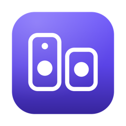
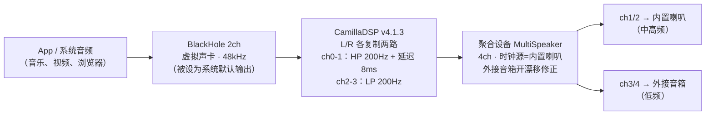

# MultiSpeaker · 多喇叭合奏



把 Mac 的**内置喇叭**和**外接音箱**当成一套声学系统来用：不是简单地把同一路全频信号同时推给两个设备，而是**先分频再分别输出** —— 内置喇叭只唱中高频，外接音箱只负责低频，再用延迟补偿把两条链路对齐。

macOS 14+ · Swift 6 · SwiftUI · 零第三方依赖 · MIT

> 下载即用，但请先读「首次使用」—— 有一条麦克风权限必须给，否则会出现"音乐在播放但没声音"。

---

## 为什么需要分频，而不是直接「多输出设备」

macOS 自带的「多输出设备」是把同一路全频立体声复制给每个设备，实际听感有三个硬伤：

| 问题 | 原因 |
|---|---|
| 低频糊、失真 | 笔记本喇叭的 3 英寸单元推不出 100Hz 以下，全频灌进去只会产生失真和风噪 |
| 相位打架、声像散 | 两只音箱距离不同、单元响应不同，同一段低频在两个箱子上叠出梳状滤波 |
| 响度不匹配 | 小喇叭灵敏度和外接音箱差 10dB 以上，一个盖住另一个 |

MultiSpeaker 用一条真正的分频链路解决：**LR4（24dB/oct）四阶分频**，分频点处两路同相叠加、衔接平直；高频链路加 0~40ms 延迟，补偿内置喇叭"先到"的时间差。

---

## 信号链路



一句话：**系统输出进 BlackHole，CamillaDSP 分频，聚合设备把 4 个声道分别送到两只喇叭。**

---

## 功能

- **一键设置**：检测/安装 BlackHole、创建聚合设备、切换系统默认输出、启动引擎，四个步骤一次完成
- **实时调音**：分频点 80–320Hz、延迟补偿 0–40ms、两路独立增益、总音量、缓冲区大小，改动 0.6 秒后自动热重启生效
- **进程看护**：每 2 秒巡检，CamillaDSP 意外退出会自动拉起（最多连续 3 次失败）；App 退出时同步回收子进程，不留孤儿占住声卡
- **菜单栏常驻**：点关闭按钮不退出，收进顶部状态栏；图标实心=正在播放、空心=已停止，弹出面板可直接调音量、启停、回主窗口
- **开机自启**：可选登录时启动 App（LaunchAgent）＋ 启动后自动开始播放
- **内置引擎**：CamillaDSP v4.1.3 已打包进 App，不用另外装
- **日志面板**：CamillaDSP 原始输出实时滚动，排障不用开终端

---

## 系统要求

| 项目 | 要求 |
|---|---|
| 系统 | macOS 14 Sonoma 或更新 |
| 芯片 | Apple Silicon（当前发布包为 arm64；Intel 需自行编译） |
| 权限 | 麦克风（必需，原因见下方「为什么要麦克风权限」） |
| 磁盘 | 约 20 MB（含内置 CamillaDSP） |

---

## 安装

### 方式一：下载发布包（推荐）

1. 下载 [`dist/MultiSpeaker.zip`](dist/MultiSpeaker.zip)（或前往 [Releases](../../releases) 页面）
2. 解压后把 `MultiSpeaker.app` 拖进 `/Applications`
3. **首次打开**：在 Finder 里右键 → 打开（App 未做 Apple 公证签名，直接双击会被 Gatekeeper 拦下）

如果仍然提示"已损坏，无法打开"，在终端执行一次：

```bash
xattr -dr com.apple.quarantine /Applications/MultiSpeaker.app
```

### 方式二：自己编译

```bash
git clone https://github.com/peterxulove/multispeaker-macos.git
cd multispeaker-macos
./build-app.sh          # 产出 MultiSpeaker.app 与 dist/MultiSpeaker.zip
```

需要 Xcode 16+（Swift 6 工具链）。仓库里已经带好了 `Resources/camilladsp`（v4.1.3），无需额外下载。

---

## 首次使用（5 步）

### 1. 装 BlackHole 2ch

「一键设置」页第 1 步会检测。没装的话点 **安装（Homebrew）**，或点「下载安装包」走官方 pkg。装完如果设备列表里还没出现，执行：

```bash
sudo launchctl kickstart -k system/com.apple.audio.coreaudiod
```

> 装 BlackHole 需要管理员密码，部分系统版本会要求重启。它是个系统级音频驱动，不是普通 App。

### 2. 允许麦克风权限（最容易卡住的一步）

第一次点「一键完成全部设置」时，系统会弹「MultiSpeaker 想要访问麦克风」。**必须点允许。**

听起来很反直觉——我们明明是在放音，为什么要麦克风？因为 BlackHole 在系统音频栈里同时是一个"输入设备"，CamillaDSP 要从它的输入端口把声音抓出来。没授权时 HAL 不会报错，只是**静默返回全零**，表现就是「音乐在播放，但一点声音都没有」。

如果当时手滑点了拒绝：`系统设置 → 隐私与安全性 → 麦克风`，把 MultiSpeaker 打开，然后重启 App。

### 3. 选两路喇叭

- **高频设备（笔记本喇叭）**：选 `MacBook Pro 扬声器`
- **低频设备（外接音箱）**：选你的外接音箱/显示器/声卡

然后点「创建 / 重建聚合设备」。这一步会在系统里建一个名为 `MultiSpeaker` 的 4 声道聚合设备：ch1/2 接高频设备、ch3/4 接低频设备。

### 4. 点「一键完成全部设置并开始播放」

它会依次做：创建聚合设备 → 把 BlackHole 设为系统默认输出 → 启动 CamillaDSP → 开始播放。绿灯亮起就说明链路通了。

### 5. 调音（可选但推荐）

切到「调音台」页，按这个顺序调：

1. **电平平衡** —— 先把外接音箱的物理旋钮拧到适中，再用两路增益把两只喇叭的响度调到一致
2. **分频点** —— 人声发闷就往上提（250–300Hz），低频空洞就往下压（120–150Hz）
3. **延迟补偿** —— 播放鼓点清晰的曲子，以 2ms 为步进试听；鼓点发散、拖沓说明没对齐
4. **总音量** —— 输出走 BlackHole 后键盘音量键会失效，用这里的滑块或菜单栏面板控制

---

## 菜单栏

点窗口左上角红叉后，App 不会退出：Dock 图标隐藏，主窗口收起，顶部状态栏留下一个音箱图标。

| 图标状态 | 含义 |
|---|---|
| 🔊 实心 `hifispeaker.2.fill` | CamillaDSP 正在播放 |
| 🔈 空心 `hifispeaker.2` | 已停止 |

点图标弹出面板，包含：运行状态、两路设备摘要、总音量滑块 + 静音、启动/停止、打开主窗口、退出。

不想用这个行为：「运行与日志」页把「点关闭按钮时收进顶部状态栏」关掉即可恢复成普通关窗。

---

## 调音参数

| 参数 | 范围 | 默认 | 说明 |
|---|---|---|---|
| 总音量 | −60 ~ 0 dB | 0 dB | 键盘音量键对 BlackHole 无效，用这个 |
| 分频点 | 80 ~ 320 Hz（步进 5） | 200 Hz | 四个滤波器同步修改，LR4 24dB/oct |
| 高频链路延迟补偿 | 0 ~ 40 ms（步进 2） | 8 ms | 加在内置喇叭路径上，对齐外接音箱 |
| 笔记本喇叭增益 | −24 ~ +6 dB（步进 0.5） | 0 dB | 两路响度对齐用 |
| 外接音箱增益 | −24 ~ +6 dB（步进 0.5） | 0 dB | 同上 |
| 缓冲区 chunksize | 512 / 1024 / 2048 | 1024 | 爆音、断续时往大调，代价是延迟变高 |

所有参数存在 `~/Library/Preferences/com.user.MultiSpeaker.plist`，生成的 CamillaDSP 配置在 `~/Library/Application Support/MultiSpeaker/multispeaker.yml`。

---

## 常见问题

**放了音乐但没声音 —— 按这个顺序查**

1. 「运行与日志」页看 CamillaDSP 是否 `Running`（不是 Paused）且无红色报错
2. 系统设置 → 声音 → 输出，确认是 `BlackHole 2ch`（被别的 App 抢走会变成静音直达）
3. 系统设置 → 隐私与安全性 → 麦克风，确认 MultiSpeaker 是开的
4. 总音量滑块是否在 −60 或勾了静音
5. 「一键设置」页看聚合设备是否还在线；被手动改过就点「重建聚合设备」

**爆音 / 断续 / 声音断一下再回来** → 缓冲区从 1024 调到 2048。多设备聚合时两条链路的时钟不可能完全一致，chunksize 太小会频繁抖动。

**只有一边喇叭响** → 聚合设备的子设备顺序被改坏了。到「一键设置」页点「创建 / 重建聚合设备」（顺序必须是高频设备在前，它同时是时钟源）。

**重启 Mac 后没声音** → 检查系统默认输出是不是被切回内置喇叭了；或者 App 的「开机自动启动」没开。

**BlackHole 装了但列表里没有** → 执行 `sudo launchctl kickstart -k system/com.apple.audio.coreaudiod` 让核心音频服务重新加载驱动；仍不行则重启。

**打开两个窗口/两个实例抢设备** → 只保留一个。音频设备同一时刻只能被一个 CamillaDSP 打开，第二个会启动失败。

**声音偏小** → 先确认外接音箱的物理音量旋钮，再用「调音台」的增益补；不要一味拉总音量（会削顶）。

更多排障细节见 [docs/USAGE.md](docs/USAGE.md)。

---

## 工作原理（几个关键实现点）

### 聚合设备怎么建的

用 CoreAudio HAL 的 `AudioHardwareCreateAggregateDevice` 编程创建，不依赖「音频 MIDI 设置」手动点：

- UID 固定为 `com.user.MultiSpeaker`，名字 `MultiSpeaker`，4 声道
- 子设备顺序 **高频设备在前**（同时作为 master / 时钟源），低频设备在后并开 `drift correction = 1`
- 顺序反了会导致声道错位甚至完全没声 —— 这是调试期踩过最大的坑

### 为什么要麦克风权限

BlackHole 是 input-capable 的虚拟设备，CamillaDSP 打开它的输入 IO 就会触发 TCC 麦克风授权。未授权时不是报错而是**返回全零样本**，从日志上完全看不出来。所以 `Info.plist` 里加了 `NSMicrophoneUsageDescription`，并在启动时主动 `AVCaptureDevice.requestAccess(for: .audio)`。

### 为什么不写 silence_threshold

CamillaDSP 4.x 有个坑：配置里带 `silence_threshold` / `silence_timeout` 时，开机 5 秒没音频就切 `Paused`，而且**收到新音频不会自动恢复**（实测连续播 10 秒仍是 Paused）。所以生成的 YAML 里彻底删掉这两项，代码里也留了注释警告。

### 进程看护

- 每 2 秒轮询一次；若"用户意图是在跑"但进程消失且设备就绪 → 自动重启，连续失败 3 次后停手并在界面报错
- `NSApplication.willTerminate` ＋ `SIGTERM/SIGINT/SIGHUP` 处理器同步 `kill(childPID, SIGTERM)`，防止 App 退出后残留的 camilladsp 占住聚合设备（这个 bug 会让"下次启动没声音"）

### 参数热更新

滑块改动 → 0.6 秒防抖 → 重新生成 YAML → `camilladsp --check` 预校验 → 停旧进程 → 等它真正退出 → 起新进程。不预校验的话，一个非法参数会让引擎停在那里不动。

### 关闭窗口不退出

`NSWindowDelegate.windowShouldClose` 返回 `false` 并 `orderOut`，同时 `NSApp.setActivationPolicy(.accessory)` 把 Dock 图标一起藏掉；从菜单栏回主窗口时再切回 `.regular`。

---

## 开发

```bash
# 编译调试
swift build --disable-sandbox

# 打包 release + .app + zip
./build-app.sh

# 重新生成应用图标（CoreGraphics 画图 → iconset → icns）
swift Resources/make-icon.swift
```

SwiftPM 在本机沙箱里需要 `--disable-sandbox`，否则会报写入受限。

### 命令行调试开关

```bash
MultiSpeaker.app/Contents/MacOS/MultiSpeaker --cli-enumerate
# 列出所有输出设备（含 UID、声道数、BlackHole/聚合设备状态、当前默认输出）

MultiSpeaker.app/Contents/MacOS/MultiSpeaker --cli-create-aggregate <高频UID> <低频UID>
MultiSpeaker.app/Contents/MacOS/MultiSpeaker --cli-default-blackhole
```

### 声学验收方法（比看日志靠谱）

想确认"到底是软件没出声还是音箱没响"，直接用麦克风量化：

```bash
# 先确认设备索引！音频设备顺序会变
ffmpeg -f avfoundation -list_devices true -i ""

# 录 4 秒并测电平（索引 3 一般为内置麦克风）
ffmpeg -f avfoundation -i ":3" -t 4 -y /tmp/mic.wav
ffmpeg -i /tmp/mic.wav -af volumedetect -f null -
```

- 环境底噪 ≈ −45 dB，正常出声 ≈ −9 ~ −31 dB，数字死寂 −91 dB
- 想更精确就加窄带滤波：`-af "bandpass=f=440:width_type=h:w=60,volumedetect"`，放 440Hz 测试音时与静音对比通常有 15dB 以上差距

---

## 目录结构

```
MultiSpeaker/
├── Package.swift                    # SwiftPM 清单（executable target）
├── build-app.sh                     # 一键构建 + 组装 .app + 签名 + 打包
├── Sources/MultiSpeaker/
│   ├── MultiSpeakerApp.swift        # @main、MenuBarExtra、CLI 调试入口
│   ├── AppCoordinator.swift         # 编排：设备/引擎/权限/看门狗
│   ├── AudioEngine.swift            # CoreAudio：枚举、聚合设备增删、默认输出
│   ├── CamillaDSPManager.swift      # 进程托管、YAML 生成、日志流、信号处理
│   ├── BlackHoleManager.swift       # 检测 / brew 安装 / pkg 安装
│   ├── LaunchAgentManager.swift     # 登录自启
│   ├── SettingsModel.swift          # 参数模型（UserDefaults 持久化）
│   ├── MenuBar.swift                # 菜单栏图标、弹出面板、窗口收起逻辑
│   ├── Views.swift                  # 三个页面：一键设置 / 调音台 / 运行与日志
│   └── Shell.swift                  # 子进程与日志行流
├── Resources/
│   ├── camilladsp                   # CamillaDSP v4.1.3（arm64，GPL-3.0）
│   ├── make-icon.swift              # 图标生成脚本
│   ├── AppIcon.icns / AppIcon-1024.png
└── dist/MultiSpeaker.zip            # 预编译发布包
```

---

## 已知限制

- 发布包是 arm64 thin binary，Intel Mac 需自行 `./build-app.sh`
- App 未做 Apple 公证（没有付费开发者账号），首次打开需右键 → 打开
- 分频滤波器固定为 LR4；想做真正的房间校正（多段 PEQ、测量卷积）目前需要自己改 YAML
- 聚合设备改动后偶尔需要 `sudo launchctl kickstart -k system/com.apple.audio.coreaudiod` 才被系统识别
- 输出被切到 BlackHole 后，键盘音量键、部分 App 的音量条会失效 —— 这是虚拟声卡的固有行为，用 App 内总音量代替

---

## 第三方组件

| 组件 | 版本 | 许可 | 用途 |
|---|---|---|---|
| [CamillaDSP](https://github.com/HEnquist/camilladsp) | v4.1.3 | GPL-3.0 | 分频 / 延迟 / 增益的 DSP 引擎，已随 App 分发 |
| [BlackHole](https://github.com/ExistentialAudio/BlackHole) | 0.6.x | GPL-3.0 | 虚拟声卡，**不随 App 分发**，由用户自行安装 |

本项目自身代码以 [MIT](LICENSE) 许可发布。注意：分发包内含 GPL-3.0 的 CamillaDSP 二进制，二次分发需遵守 GPL-3.0。
