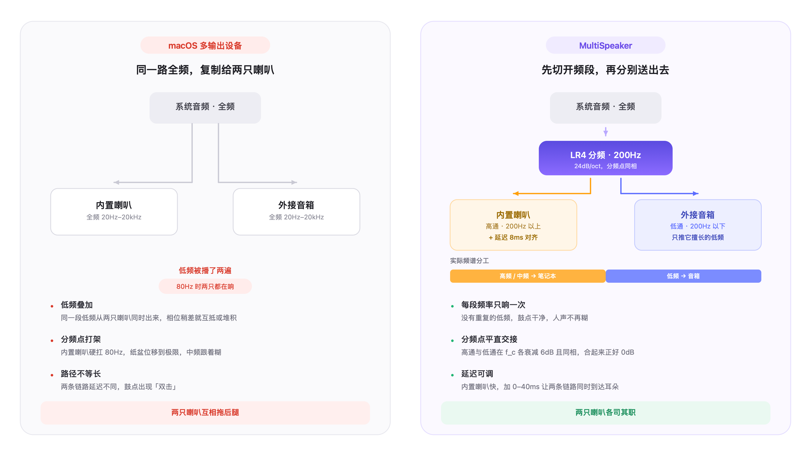
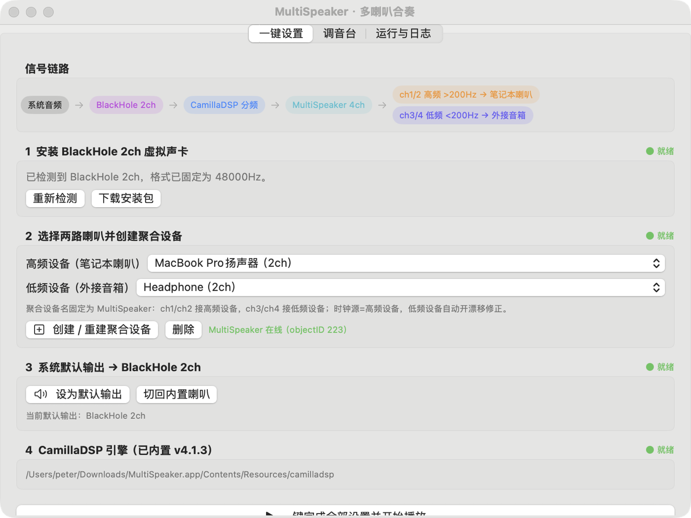
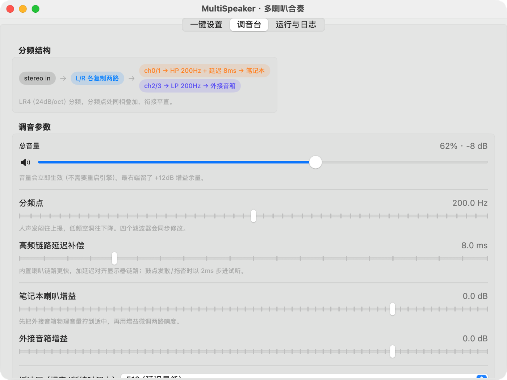
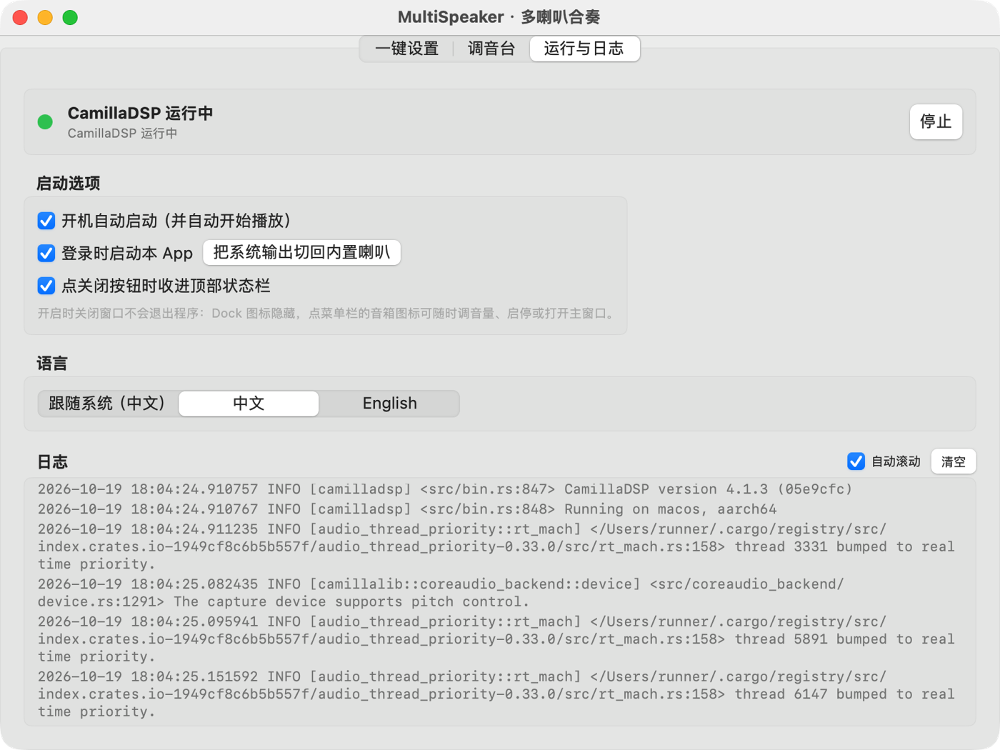

两只喇叭一起响，原本是个坏主意

（长文终稿 · 用于 X 长贴。正文已是纯文本，可直接复制；图片按位置内嵌，发帖时替换成上传的图。）

一、先说结论

把 Mac 的内置喇叭和外接音箱同时勾上，声音会更响，但更难听。

这不是错觉。macOS 的「多输出设备」本质上是复制：同一路全频信号，原封不动地送给每一只喇叭。低频被播两遍，中高频在空气里互相干涉，两条链路延迟还各不相同——它从来不是为「一起听」设计的。

我花了几天做了个反面的事：先把频段切开，再分别送出去。内置喇叭只唱它擅长的中高频，外接音箱只推低频，然后用延迟补偿把两条链路对齐。结果是终于像「一套系统」，而不是「两只喇叭」。

开源，免费，macOS 14+，Apple Silicon。

二、为什么「复制粘贴」注定不好听

多输出设备有三个先天问题，全都来自「不做分工」：

① 同一段低频被播了两遍。
内置喇叭和外接音箱都还在 60–200Hz 有输出，声音在空气里叠加。同一相位时低频总量翻倍（听起来就是「轰」），稍有相位差就变成互抵（听起来是「空」）。而且是随位置、随频率变化的——你永远调不准。

② 内置喇叭被逼着干了它干不了的活。
MacBook 的内置喇叭在 80Hz 附近的位移已经接近极限。硬让它唱低频，纸盆大幅度前后跑动，中频会跟着被调制——人声发毛、发糊，就是这么来的。

③ 两条链路不等长。
内置喇叭是直连的，外接走 USB / DAC / 蓝牙，延迟差几毫秒。几毫秒就够在梳状滤波上打出第一个凹口，鼓点听起来「双击」，人声发虚。

〔图 1 · 发帖时在此上传 docs/diagram-why.png〕

三、正确做法：先分频，再输出

分频是音箱设计里最基础的一件事：让每只单元只在它擅长的频段工作。既然手里有两只特性完全不同的喇叭，就该这么用。

我选了 200Hz 作为分频点，滤波器用 LR4（Linkwitz-Riley 4 阶，24dB/oct）。

选它不是因为名字好听，是因为它有一个必要的数学性质：在分频点 f_c 处，高通和低通各衰减 6dB，而且相位一致。两路叠加正好回到 0dB。这意味着交接是平直的，没有台阶、没有相位撕裂。

如果用二阶 Butterworth，在 f_c 处两路同相叠加会多出 +3dB，听感就是分频点那一小段「凸」出来，像鼻音。LR4 就是专门解决这个问题的。

顺序也很关键：分频必须在输出之前，而不是两只喇叭都放完了再指望它们自己协调。

四、延迟补偿：那 8 毫秒

分频解决了「谁唱什么」，但没解决「什么时候唱」。

内置喇叭物理上更靠近耳朵、链路更短，声音到得更早；外接音箱经过 USB/DAC，慢几毫秒。这两路如果不同时到达，分频点附近就会出现干涉。

所以我在内置喇叭这一路加了延迟（默认 8ms，可调 0–40ms）。为什么加在内置而不是外接？因为延迟只能加、不能减——要让快的那路等慢的那路。

怎么调：放一段鼓点清晰的歌，如果有「双击」感或低频发拖，就 2ms 一步往上加，直到低频收紧、瞬态变实。

五、这条链路是怎么搭起来的

macOS 没有现成的分频器，所以需要三块积木。

第一步，用 BlackHole 抓系统输出。BlackHole 2ch 是一个虚拟声卡，把系统默认输出设成它，所有 App 的声音就流进了它的输入侧——这让「系统音频」变成一条可以被处理的信号。

第二步，造一个 4 声道聚合设备。它是整个方案的枢纽：ch1/2 送给内置喇叭，ch3/4 送给外接音箱。时钟主设备选内置喇叭那一路（更稳定），外接设备开漂移修正。这一步的关键是声道分配和主从顺序——顺序反了，高频和低频就互换了，声音会变得很怪。

第三步，中间插进 CamillaDSP 做滤波。它负责两件事：把立体声复制成两路，各自过高通 / 低通，再加上延迟和增益。

整条链路是：

系统音频 → BlackHole 2ch → CamillaDSP 分频 → MultiSpeaker 4ch 聚合设备
　　　　　　　　　　　　　　　　　　　   ├ ch1/2 → 内置喇叭（高通 200Hz）
　　　　　　　　　　　　　　　　　　　   └ ch3/4 → 外接音箱（低通 200Hz）

听起来步骤很多。所以这个 App 把四步做成了一键：检测/安装 BlackHole、创建聚合设备、切换默认输出、启动引擎。

〔图 2 · 发帖时在此上传 docs/screenshot-setup-zh.png〕

六、App 里几个我认为必要的设计

【实时音量，而不是重启引擎】
第一版把总音量写进了 CamillaDSP 的配置文件，改一次音量就要重写 YAML + 重启引擎——拖动滑块时声音一顿一顿。后来改成走 CamillaDSP 的 websocket，SetVolume 直接下发，拖动即时生效，引擎完全不动。

【音量曲线按听觉走，不按 dB 走】
这是第一版最失败的地方：滑块 0–100% 线性映射到 −60~0dB。你拖到 30%，实际已经是 −42dB，听起来等于没声。人耳对响度的感知接近对数，所以曲线的正确形状是「大部分衰减集中在左侧」。现在 25% = −26.5dB、50% = −12dB、100% = +12dB，位置和 dB 互为逆运算，往返误差 0。

【上限抬到 +12dB】
多输出设备链路上，键盘音量键是失效的（它控制的是物理设备），App 内滑块是唯一入口，必须留出增益余量。超过 +3dB 会变橙色提示可能削顶。

【进程看护】
CamillaDSP 意外退出，音频就断了。App 每 2 秒巡检一次，发现该在跑却没跑就自动拉起，连续失败 3 次才停手。退出时先发 SIGINT 让引擎干净退出，避免留下孤儿进程占住声卡——这个坑我踩过：孤儿进程会让下次启动直接没声音，而且看起来毫无异常。

【关窗不退出】
音频工具是「设好就忘」的东西。所以点红叉直接收进顶部状态栏，图标实心=正在播放、空心=已停止，弹出来就能调音量、启停。

〔图 3 · 发帖时在此上传 docs/screenshot-mixer-zh.png〕

七、三个让我熬到半夜的坑

这部分可能对写音频代码的人有用，都是「看起来莫名其妙、实际上有明确原因」的问题。

坑 1：没有麦克风权限，CoreAudio 不会报错，只会给你全零。
现象是「音乐在播放，但一点声音都没有」，而所有设备状态都显示正常、IO 在跑、电平表有数。原因是聚合设备创建时系统需要麦克风权限（虚拟声卡的输入侧被视为录音），未授权时 HAL 静默返回全零缓冲区，不抛错。补上 NSMicrophoneUsageDescription 并主动 requestAccess 之后立刻好了。这是整个项目里最反直觉的一个坑，我把它写进了文档的显著位置。

坑 2：把 -g -5.0 这么写，引擎会直接启动失败。
命令行解析器把 -5.0 当成了一个新选项，于是报错退出。必须写成「-g=-5.0」。这一条让我反复怀疑是配置问题。

坑 3：silence_threshold 会让引擎永久 Paused。
为了省电加了静音检测，结果暂停播放一段时间后引擎进入 Paused 状态，再也没恢复过——后续所有声音都被吞掉。最后把这个配置彻底删掉，并留了注释禁止再添加。

还有一个验证方法值得记：判断「到底有没有出声」不要靠耳朵，用 ffmpeg 从麦克风录音，做 440Hz 窄带能量对比。有音 −31.3dB、静音 −47.6dB，差 16dB，一测就知道。前提是先 -list_devices 确认设备索引——我就曾经因为索引变了，从 Background Music 录了 4 秒死寂，差点误判。

〔图 4 · 发帖时在此上传 docs/screenshot-runtime-zh.png〕

八、适合谁，不适合谁

适合：桌面上有闲置音箱，又不想它和内置喇叭各响各的；想要「一套系统」的感觉，低频交出去、中高频留给更近的那只；愿意花 10 分钟调延迟和增益，换来长期不用再动。

不适合：追求绝对保真（这条链路上有虚拟声卡、重采样、DSP，不是「转录」路径）；不想装额外驱动（BlackHole 是必须的）；期待「变大声」（数字增益换不来功率，物理上限还是那两只喇叭）。

九、地址

开源，MIT 许可（分发包内含 GPL-3.0 的 CamillaDSP，已在 LICENSE 注明）。

github.com/peterxulove/multispeaker-macos

解压即用，不用装依赖。首次运行记得给麦克风权限——不给就会出现「有音乐但没声音」，也就是上面的坑 1。

────────────────────────────────

附：配图清单

编号  文件                              位置        内容
1     docs/diagram-why.png              第二节之后  多输出设备 vs 分频输出 对比图（自制，3200×1800）
2     docs/screenshot-setup-zh.png      第五节之后  一键设置页：信号链路 + 四步状态
3     docs/screenshot-mixer-zh.png      第六节之后  调音台：分频 / 延迟 / 双路增益 / 实时音量
4     docs/screenshot-runtime-zh.png    第七节之后  运行与日志：引擎状态、开机自启、双语切换

图 1 是自制的，建议当首图——对比关系一眼能看懂，比任何一张界面截图都更适合做封面。X 一条帖最多挂 4 张图，正好用完。

附：发帖方式

这篇远超普通账号的 280 字符限制，只有两条路：

1）Premium 长推文：直接粘贴全文（限制 25000 字符），图片在对应位置逐张上传。粘贴前把「〔图 N · …〕」那一行、以及紧跟的那行图片引用删掉，换成实际上传的图。

2）拆成 thread：下面给了 9 条，按顺序发，每条都能独立成立。

附：Thread 拆解版（9 条）

1/
把 Mac 的内置喇叭和外接音箱同时勾上，声音会更响，但更难听。

不是错觉。macOS 的「多输出设备」本质是复制：同一路全频信号送给每只喇叭。低频播两遍，中高频在空气里互相干涉。

它从来不是为「一起听」设计的。

2/
三个先天问题：

① 低频被播两遍——同相时轰，稍有相位差就互抵，随位置随频率变，永远调不准
② 内置喇叭被逼着唱 80Hz，纸盆位移到极限，中频跟着被调制，人声发毛
③ 内置直连、外接走 USB，差几毫秒就够在梳状滤波上打出凹口，鼓点听起来「双击」

3/
正确做法是分频：让每只喇叭只在它擅长的频段工作。

200Hz 切开，用 LR4（24dB/oct）。

选它是因为一个数学性质：在分频点处高通和低通各衰减 6dB 且相位一致，叠加正好回到 0dB。交接平直，没有台阶。

换成二阶 Butterworth，分频点会多出 +3dB，听起来像鼻音。

4/
然后补延迟。

内置喇叭离耳朵近、链路短，到得早；外接经过 USB/DAC，慢几毫秒。不同时到达，分频点附近就干涉。

所以给内置那一路加延迟（默认 8ms）。只能加不能减——让快的等慢的。

调法：放鼓点，有「双击」感就 2ms 一步往上加，直到低频收紧。

5/
链路得自己搭，macOS 没有现成的分频器：

系统音频 → BlackHole 2ch（虚拟声卡抓输出）→ CamillaDSP 分频 → 4 声道聚合设备
　　　　　　　　　　　　　　　　　　　　　├ ch1/2 → 内置喇叭（高通）
　　　　　　　　　　　　　　　　　　　　　└ ch3/4 → 外接音箱（低通）

关键是聚合设备的声道分配和主从顺序。反了，高频低频就互换了。

6/
我把它做成了一个 App：四步一键完成——检测安装 BlackHole、创建聚合设备、切换默认输出、启动引擎。

加上实时音量（走 websocket，不重启引擎）、进程看护（2 秒巡检，挂了自动拉起）、关窗收进菜单栏。

中英双语，免费开源。

7/
一个必须说的坑：没有麦克风权限，CoreAudio 不报错，只给你全零。

现象是「音乐在播放但没声音」，而所有状态都正常、IO 在跑、电平有表。

因为聚合设备的输入侧被当成录音，未授权时 HAL 静默返回全零，不抛错。补上 NSMicrophoneUsageDescription + 主动 requestAccess 立刻就好。

8/
另外两个坑：

· camilladsp -g -5.0 会被解析器当成新选项，必须写 -g=-5.0
· silence_threshold 会让引擎永久 Paused，之后所有声音被吞，只能删掉

验声别靠耳朵：ffmpeg 录麦克风做 440Hz 窄带能量对比。有音 −31.3dB / 静音 −47.6dB，差 16dB。

9/
适合：桌上有闲置音箱，又不想它和内置喇叭各响各的。
不适合：追求绝对保真，或者期待「变大声」——数字增益换不来功率。

开源，MIT，解压即用。
首次运行记得给麦克风权限。

github.com/peterxulove/multispeaker-macos
